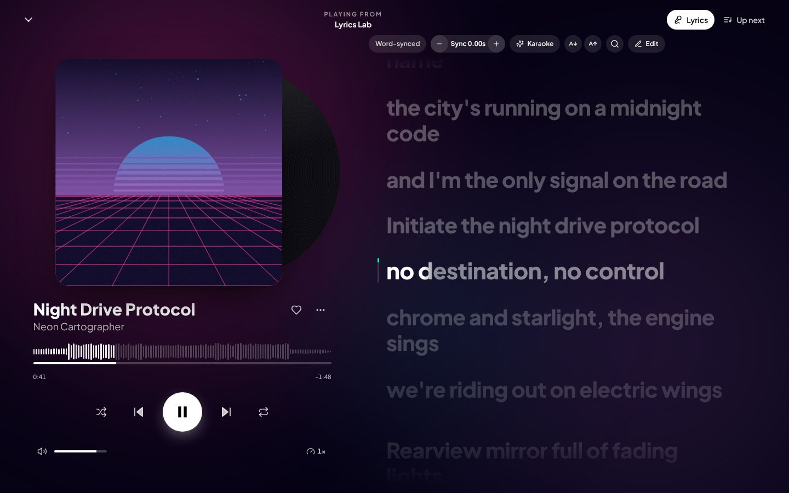
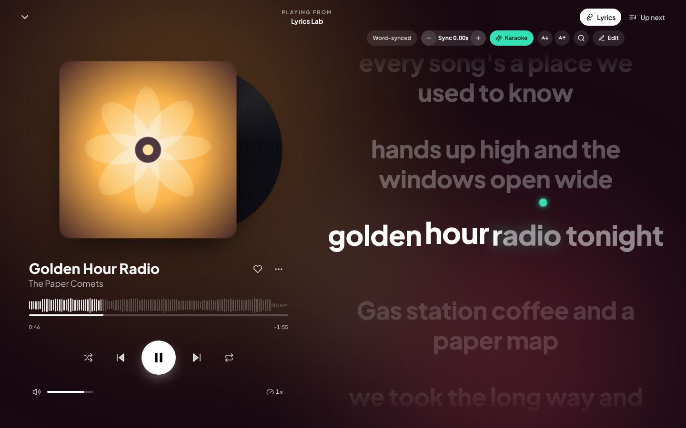
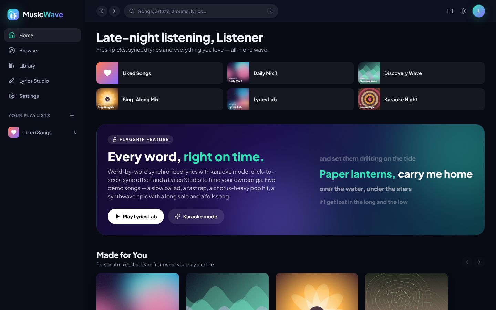
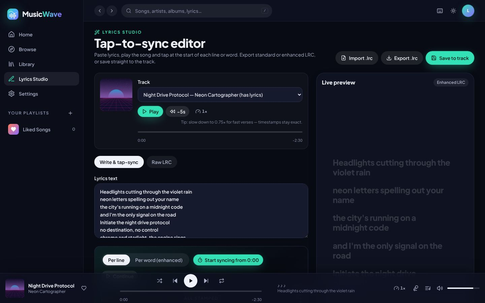
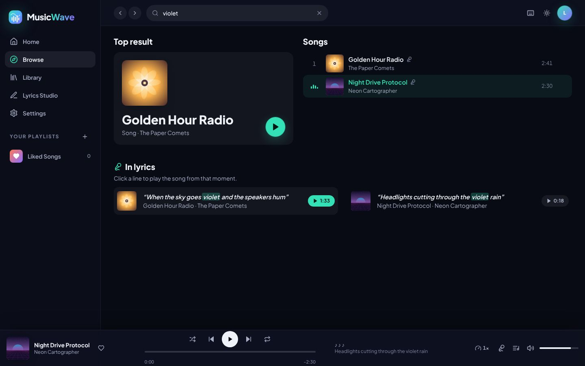
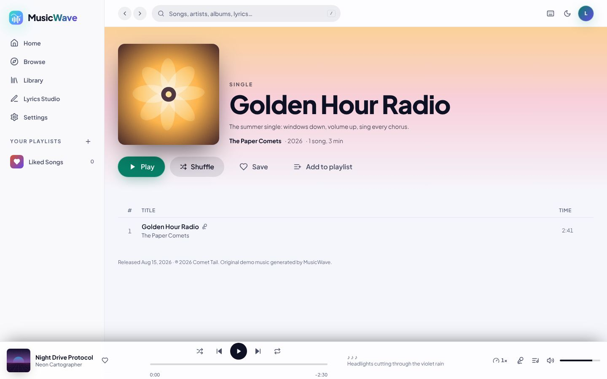
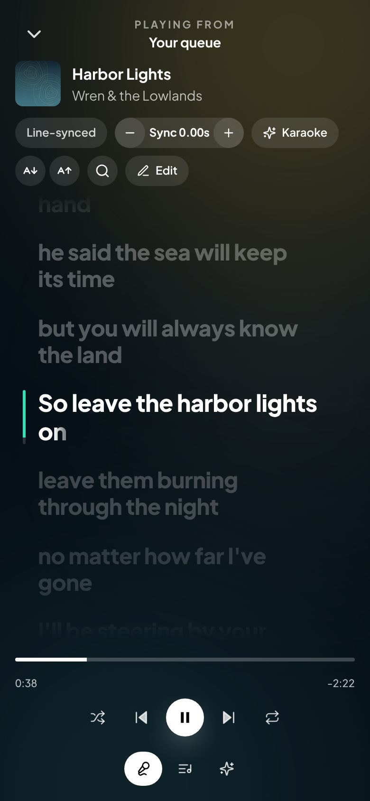

# MusicWave

An original music streaming web app with a **real, searchable music library**, selectable streaming quality (**High Quality, Lossless, Hi-Res Lossless**), **downloads for offline listening**, and **synchronized lyrics fetched automatically** for what you play — plus word-by-word karaoke and a tap-to-sync Lyrics Studio.

Built with React 18, TypeScript, Tailwind CSS and Vite. Music comes from open sources that allow free streaming and downloading:

- **[Audius](https://audius.co)** — millions of full-length tracks uploaded by independent artists (trending, genres, artists, albums, playlists). Lossless originals when the artist allows downloads.
- **[Internet Archive](https://archive.org)** — the Live Music Archive (many lossless and 24-bit concert recordings), public-domain 78s and Creative Commons netlabel releases.
- **[LRCLIB](https://lrclib.net)** — a community database of synced (LRC) and plain lyrics, looked up automatically for every online song.

The app also ships **MusicWave Originals**: 16 demo songs composed as data and synthesized in your browser, 5 of them with hand-timed word-by-word lyrics, so lyrics and playback work even with no network at all.

| Now Playing + synced lyrics | Karaoke mode |
| --- | --- |
|  |  |
| **Home (dark)** | **Lyrics Studio** |
|  |  |
| **Search inside lyrics** | **Light theme** |
|  |  |

<p align="center"></p>

---

## Quick start

Requires Node 18.18 or newer (developed on Node 22).

```bash
npm install
npm run dev          # http://localhost:5173
```

| Command | What it does |
| --- | --- |
| `npm run dev` | Dev server with hot reload |
| `npm run build` | Type-check and build a production bundle into `dist/` |
| `npm run preview` | Serve the production build locally |
| `npm test` | Run the Vitest suites (116 tests) |
| `npm run lint` / `npm run typecheck` | ESLint / TypeScript |
| `npm run generate:lrc` | Regenerate the demo `.lrc` files from the song compositions |

> The first time you play a demo track it is synthesized in the background, which takes about 1–3 s on a typical laptop (a progress ring shows in the play button). While a song plays, the next one is pre-rendered, and the last 6 renders are cached in IndexedDB so replays start instantly.

`dist/` is a static single-page app. Deploy it to any static host with an SPA fallback to `index.html` (Netlify, Vercel, Cloudflare Pages, nginx `try_files`).

---

## Real music: sources, quality, downloads and lyrics

### Where the music comes from

| Source | What you get | Rights |
| --- | --- | --- |
| Audius (`api.audius.co`) | Trending (week / month / year / all time, per genre), underground trending, search for songs, artists and playlists, artist pages and albums. Full tracks stream as MP3. | Uploaded and shared by the artists themselves for free streaming. Gated (paid / collectible) tracks are filtered out. |
| Internet Archive (`archive.org`) | Search across concert recordings, 78 rpm records and netlabel albums; Hi-Res & lossless concert shelves. Every rendition of each track (24-bit FLAC, FLAC, WAV, AIFF, MP3, Ogg) is kept as a separate quality variant. Stream-only (`private`) files are skipped. | Public domain, Creative Commons, or taper-friendly bands that allow free trading. Each recording links to its source page and license. |
| LRCLIB (`lrclib.net`) | Synced or plain lyrics, matched by title, artist and track length. | Community-contributed. Credited in the lyrics view. |

> **Why not the big-label catalog?** Full-length streaming and downloading of major-label music requires licenses from the labels; there is no legal free API for it. MusicWave deliberately uses only sources whose content may be streamed and downloaded for free, and it does not scrape, rip or proxy any other service.

Everything you touch — tracks, albums, artists — is registered in a local catalog (`state/remoteCatalog.ts`, persisted to localStorage), so online songs can be liked, queued, added to your playlists, downloaded and shown in history exactly like built-in ones, and keep working after a reload or offline.

### Streaming and download quality

Pick separate qualities for **streaming** and **downloads** in *Settings → Audio quality*, or switch the current song from the quality badge in Now Playing (the position is kept).

| Tier | Meaning | Typical size |
| --- | --- | --- |
| **High Quality** | Lossy MP3 / Ogg / AAC | ≈ 1–2.5 MB / min |
| **Lossless** | FLAC / WAV / AIFF / ALAC up to 24-bit / 48 kHz | ≈ 5–15 MB / min |
| **Hi-Res Lossless** | Lossless above 48 kHz (24-bit / 88.2–192 kHz) | ≈ 15–50 MB / min |

Labels are honest — they describe the actual file, not a marketing promise:

- Lossless candidates are **inspected** before use. MusicWave reads the first 64 KB of the file and parses its header (FLAC `STREAMINFO`, WAV `fmt `, AIFF `COMM` with its 80-bit sample rate) to get the real bit depth and sample rate. For Audius originals it first asks `/tracks/{id}/inspect` for the real content type.
- **Hi-Res is only shown once the header proves more than 48 kHz.** A "24bit Flac" listing on the Internet Archive stays *Lossless* until verified; a 24-bit / 48 kHz file is *Lossless*.
- If a source hands over a lossy file instead of a lossless original, the download is re-labelled *High Quality*.
- The choice falls back automatically: if the requested tier doesn't exist for a song, the best available version plays. If a rendition fails to load (blocked host, unsupported codec), the next best is tried.
- Formats your browser can't decode are skipped (*Settings* lists what yours supports).

Where to find lossless and Hi-Res: the *Hi-Res & Lossless Live* and *Lossless Concerts* shelves on Home, the **Lossless only** filter in Search → Live & Archive, and Audius tracks whose artists upload WAV / FLAC / AIFF masters and allow downloads.

### Downloads and offline

- **Download** any song (⋯ menu), or a whole album, playlist or recording (Download button on its page). Two downloads run at a time with progress rings, cancel and retry.
- Each download stores the audio file in the quality chosen in *Settings → Downloads*, its **artwork** and its **lyrics** in IndexedDB.
- The **Downloads** page (sidebar and mobile tab bar) lists everything saved with its exact quality ("24-bit / 96 kHz FLAC"), filters by tier, total size and browser storage use, plus Play / Shuffle.
- **Offline is automatic**: when the device loses its connection (or you switch on *Offline mode*), a banner appears, online shelves show a calm notice instead of errors, search looks through your downloads, and downloaded songs play from the device with lyrics and artwork.
- In production builds a **service worker** (`scripts/serviceWorker.ts`, generated at build time) precaches the app shell, so MusicWave itself opens offline. It never caches audio or API responses.

### Lyrics for online songs

Lyrics are looked up on LRCLIB as soon as an online song starts (cached in IndexedDB, saved with downloads):

- **Synced lyrics** are used only when the LRCLIB recording is within 2.5 s of the song's length; otherwise the timestamps belong to another version (live take, radio edit), so the lyrics are shown **unsynced** with a note.
- Titles are cleaned before matching ("(Official Audio)", "feat.", "prod.", "– Remastered"), and search results must match both title and artist.
- States for loading, not found, instrumental, offline and errors (with retry). Everything else — highlighting, click-to-seek, ±0.25 s offset, karaoke, in-lyrics search, mini-player lyrics — works the same as for the originals. If LRCLIB has nothing, the Lyrics Studio can sync them by tapping, and your version overrides the online one.

### Network requirements

The browser talks directly to the sources (all support CORS). If you deploy MusicWave behind a firewall or in a sandbox with an allowlist, allow:

- `api.audius.co` **and the Audius content nodes it redirects streams and downloads to** (these are many different hosts run by node operators), plus artwork hosts;
- `archive.org` and `*.us.archive.org` (archive.org redirects downloads to numbered servers);
- `lrclib.net`.

If a host is blocked, its shelves show *Couldn't load this right now* with a Retry button, and everything else keeps working. Optionally paste a free **Audius API key** in *Settings → Music sources* for higher rate limits — only the public key, never a secret or bearer token.

---

## Features

### Lyrics (the flagship)
- **Standard and enhanced LRC.** Supports `[mm:ss.xx]` lines, repeated timestamps (`[t1][t2]chorus`), `<mm:ss.xx>` word and syllable stamps, empty-line break markers, `[offset:]`, and ID tags. Plain untimed lyrics also work.
- **Word-by-word fill.** Each word fills with a soft-edged gradient as it is sung. If the file only has line timestamps, progress is **interpolated across the line**, weighted by syllable count.
- **Line states.** The active line is highlighted, past lines are dimmed, and the next line is previewed. Each line becomes active **0.32 s before it is sung**, so your eyes arrive first, but never while the previous line is still being sung.
- **Instrumental breaks** show animated interlude dots. Karaoke mode adds a **3-2-1 countdown** before the next line.
- **Auto-scroll** keeps the active line centered with a spring animation. Scrolling manually pauses it (with a "Back to live lyrics" button), and it resumes after 5 s.
- **Click any line to seek** there; the sync offset is taken into account.
- **Sync offset** in ±0.25 s steps (buttons, or the `[` / `]` keys), saved per song. A separate global **audio-latency compensation** setting handles Bluetooth headphones.
- **Karaoke mode:** large centered text, glowing sung words, a **bouncing ball** that hops from word to word, and countdowns.
- **Lyric search:** find text within the open song (highlighted matches you can step through), or search across all songs from Browse. Global results jump to the exact moment in the song.
- **Mini-player lyrics:** the current and next lines appear in the bottom bar on wide screens.
- **Lyrics Studio:**
  1. Paste lyrics.
  2. Tap Enter, T or ↓ on every line, or on every word for enhanced LRC. Backspace undoes; B marks an instrumental break.
  3. Fine-tune with the editable timestamps (±0.05 s nudges, "Set to now", "Sync from here"), or edit the raw LRC.
  4. Import or export `.lrc`, copy to the clipboard, or **save to the track**.

  A live preview uses the same sync engine as the player. Reaction-time compensation (default 120 ms) is subtracted from every tap.
- **Stays in sync** through seeks, pauses, playback-speed changes (0.5×–2×, pitch preserved) and track switches. Every frame is computed from the current time alone, so there is no state to drift.

### Player
- A mini player that expands into a full-screen **Now Playing** view with:
  - an ambient background that breathes with the music's loudness,
  - a spinning vinyl record,
  - a waveform seek bar.
- Play/pause, next/previous (previous restarts the song after 3 s), seek, volume, mute, shuffle, repeat (off → all → one) and playback speed.
- **Queue:** Up next, Play next / Add to queue, **drag-to-reorder** (mouse, touch and keyboard), remove, clear, and "Played this session".
- **Keyboard shortcuts:**

  | Keys | Action |
  | --- | --- |
  | Space | Play / pause |
  | ← / → | Seek 5 s (Shift: 15 s) |
  | N / P | Next / previous |
  | Shift + ↑ / ↓ | Volume |
  | M | Mute |
  | S | Shuffle |
  | R | Repeat |
  | L | Lyrics |
  | K | Karaoke |
  | Q | Queue |
  | [ / ] | Lyrics offset −/+ 0.25 s |
  | F | Like |
  | / | Search |
  | ? | Shortcut help |

- **OS media controls** via the Media Session API (lock screen, hardware media keys).
- **Resumes where you left off:** queue, position, volume, speed, shuffle and repeat are persisted.
- **Graceful errors:** loading failures show a toast and auto-skip; autoplay blocks and offline tracks are explained.

### Browse, Library and the rest
- **Home:** time-of-day greeting, quick picks, Recently Played, and live shelves — *Trending Now*, *Hi-Res & Lossless Live*, *Popular Playlists*, *Browse by Genre*, *Underground Trending*, *Lossless Concerts*, *Golden Age 78s*, *Netlabel Releases* — each with skeletons, error/retry and offline states. Below them, the MusicWave Originals: a Lyrics Lab spotlight, *Made for You* mixes, New Releases, Top Charts, genre shelves, featured playlists and artists. Carousels snap and have arrow buttons.
- **Search:** one box searches everything — Audius songs, artists, albums and playlists, Internet Archive recordings (with a *Lossless only* filter) and the Originals, including **inside lyrics**. Filter chips (All, Songs, Artists, Albums & Playlists, Live & Archive, MusicWave Originals), 300 ms debounce, cancellation of stale requests, and per-section loading and error states. Offline, it searches your downloads. Empty box: genre tiles (each opens a trending page with week / month / year / all-time ranges) and recent searches.
- **Library**, all persisted to localStorage:
  - **Playlists:** create, rename, delete, add and remove songs.
  - **Liked Songs**, saved albums, followed artists and recently played.
  - Saved online albums and playlists and followed online artists appear next to the built-in ones.
  - **Downloads** (its own page): see above.
  - **Uploads:** import your own audio files and attach `.lrc` files.
- Album, artist, playlist, mix, genre, charts and new-release pages, plus pages for online albums / playlists / recordings (`/collection/:id`), online artists and online genres (`/browse/:genre`).
- **Settings:** streaming and download quality, music sources (Audius, Internet Archive, automatic lyrics, optional Audius API key), theme (dark, light or system), name, motion, vinyl artwork, karaoke, lyric size, latency compensation, offline mode, caches and reset.

### Design and accessibility
- An original identity: deep-ink backgrounds, "tide" teal, "iris" violet and "ember" coral; a custom wave logo; and the Plus Jakarta Sans typeface.
- Every cover, avatar and genre tile is **generated SVG art** (12 styles: synthwave horizon, topographic, lanterns, pixel and more).
- Dark mode by default plus a light theme. The Now Playing view stays immersive (album-tinted dark) in both.
- Responsive from 320 px phones to wide desktops: sidebar on desktop, bottom tab bar and compact player on mobile.
- Accessibility:
  - Semantic landmarks, a skip link, and labelled icon buttons, sliders and toggles.
  - Visible focus rings and keyboard support for everything, including drag-to-reorder.
  - Focus-trapped dialogs. The app becomes `inert` behind the full-screen player.
  - A live region announces track changes.
  - Reduced-motion support (system setting or in-app).
  - Body text and controls meet WCAG AA contrast; inactive lyric lines are deliberately dimmed so the active line stands out.

---

## Architecture

```
┌────────────────────────── UI (React components / pages) ─────────────────────────────┐
│ Home · Search · Library · Album/Artist/Playlist · Lyrics Studio · Settings           │
│ PlayerBar · NowPlaying · QueuePanel · LyricsView · MiniLyrics                        │
└──────────────┬───────────────────────────────────────┬───────────────────────────────┘
               │ selectors (useSyncExternalStore)      │ per-frame time (no re-render)
┌──────────────▼───────────────┐        ┌──────────────▼───────────────────────────────┐
│ state/  (tiny stores)        │        │ hooks/useLyricsSync ─▶ services/lrc/timing   │
│ player · library · settings  │        │   binary search active line, write --p on     │
│ lyrics overrides · ui        │        │   each word <span> every animation frame      │
│ persisted → localStorage     │        └──────────────▲───────────────────────────────┘
└──────────────┬───────────────┘                       │ clock.now()
               │ initPlayer() reconciles store ⇄ element│
┌──────────────▼────────────────────────────────────────┴───────────────────────────────┐
│ services/audioEngine  HTMLAudioElement + PlaybackClock (smooth, monotonic media time) │
│ services/audioSources  url │ upload (IndexedDB) │ synth (memory LRU → IndexedDB → worker)│
│                        remote: download (IndexedDB) → remoteAudio.selectVariant(tier) │
└──────────────┬──────────────────────────────────────────┬────────────────────────────┘
               │                                          │ inspect header, rank variants
               │                ┌─────────────────────────▼────────────────────────────┐
               │                │ services/providers  audius · archive · lrclib (fetch) │
               │                │ services/onlineCatalog → state/remoteCatalog (persisted)│
               │                │ services/downloads (queue, progress, artwork, lyrics) │
               │                │ services/remoteLyrics (LRCLIB + IndexedDB cache)      │
               │                └──────────────────────────────────────────────────────┘
               │ renderCompositionAudio()
┌──────────────▼───────────────────────────────────────────────────────────────────────┐
│ audio/synth  (Web Worker pool, pure JS DSP)                                          │
│ composition ─▶ arrangement compiler ─▶ samples + voices ─▶ reverb/delay ─▶ WAV        │
│                     └─▶ timed lyrics ─▶ scripts/generate-lrc.ts ─▶ src/data/lyrics/*.lrc│
└──────────────────────────────────────────────────────────────────────────────────────┘
```

### File tree

```
musicwave/
├── index.html
├── package.json · vite.config.ts · tailwind.config.ts · postcss.config.js · eslint.config.js · tsconfig*.json
├── public/
│   ├── favicon.svg                 # original logo mark
│   └── audio/                      # drop your own MP3s here (served at /audio/…)
├── scripts/
│   ├── generate-lrc.ts             # composition → .lrc files (keeps lyrics and audio identical)
│   └── serviceWorker.ts            # Vite plugin: emits sw.js precaching the built app shell
├── docs/screenshots/               # images used in this README
├── tests/                          # Vitest: parser, timing, fixtures, engine, draft, search, queue, clock,
│                                   #   quality (headers, ranking), providers (mappers), online (LRCLIB, inspection)
└── src/
    ├── main.tsx · App.tsx · index.css        # entry, routes, design tokens + lyric styles
    ├── types/                      # Track, Album, Artist, Playlist, Genre, LyricLine, LyricWord, PlayerState…
    ├── data/
    │   ├── catalog.ts              # artists, albums, tracks, playlists, genres, palettes
    │   ├── compositions/           # 16 original songs as data (5 with lyrics)
    │   └── lyrics/*.lrc + index.ts # generated demo LRC files (auto-discovered)
    ├── audio/synth/
    │   ├── theory.ts               # keys, modes, roman-numeral chords, voicing
    │   ├── styles.ts               # 12 genre presets: grooves, patches, mix
    │   ├── arrangement.ts          # composition → note events + guide-vocal syllables + timed lyrics
    │   ├── samples.ts              # drums, piano/e-piano, Karplus–Strong guitar, bells, arps
    │   ├── dsp.ts                  # PolyBLEP oscillators, ZDF state-variable filter, FDN reverb, delay
    │   ├── engine.ts               # mixes everything → stereo PCM → WAV + waveform/energy analysis
    │   ├── synthWorker.ts · client.ts  # Web Worker + priority pool (foreground pre-empts prefetch)
    │   └── lyricsExport.ts         # arrangement → LRC (used by the generator and tests)
    ├── services/
    │   ├── lrc/                    # parser · serializer · timing (timeline, interpolation) · syllables · draft (Studio)
    │   ├── audioEngine.ts          # <audio> wrapper + PlaybackClock
    │   ├── playbackTicker.ts       # one shared rAF loop that fans out the clock
    │   ├── audioSources.ts         # resolve/prefetch/download audio, caches
    │   ├── providers/              # audius.ts · archive.ts · lrclib.ts · http.ts (API clients + mappers)
    │   ├── quality.ts              # tiers, header parsing (FLAC/WAV/AIFF), variant ranking, labels
    │   ├── remoteAudio.ts          # inspect lossless files, pick a variant, current playback quality
    │   ├── onlineCatalog.ts        # queries that register results in the remote catalog
    │   ├── downloads.ts            # download queue with progress, artwork + lyrics, offline artwork
    │   ├── remoteLyrics.ts         # automatic LRCLIB lyrics with IndexedDB cache
    │   ├── online.ts               # startup wiring (API key, registry references, artwork)
    │   ├── offlineStore.ts · storage.ts   # IndexedDB (audio, uploads, lyrics, artwork) · versioned localStorage
    │   ├── catalog.ts · search.ts · recommendations.ts · lyrics.ts · uploads.ts
    ├── state/                      # createStore + player / queue / library / settings / lyrics / ui stores,
    │                               #   remoteCatalog (online tracks/albums/artists), networkStore (online/offline)
    ├── hooks/                      # usePlaybackTime, useLyricsSync, useLyrics, useKeyboardShortcuts, useMediaSession…
    ├── providers/AppProviders.tsx  # theme + player binding + shortcuts + media session
    ├── components/
    │   ├── layout/                 # AppShell, Sidebar, TopBar, MobileNav, ThemeProvider
    │   ├── player/                 # PlayerBar, NowPlaying, Controls, SeekBar, VolumeControl, SpeedMenu, Queue*
    │   ├── lyrics/                 # LyricsView, LyricLine, LyricsToolbar, MiniLyrics
    │   ├── cards/ · collection/ · dialogs/ · common/ · art/
    └── pages/                      # Home, Search, Genre, BrowseGenre, Album, Collection, Artist, Playlist, Mix,
                                    # Charts, NewReleases, Library, Downloads, LyricsStudio, Settings, NotFound
```

---

## How lyric sync works

1. **Parsing** (`services/lrc/parser.ts`) produces lines and segments with absolute start and end times.
   - Line ends are explicit when possible (an enhanced end tag or a break marker). Otherwise they are estimated: lines that run into the next one end at that line's start, and lines followed by long gaps get a duration based on the song's typical line length.
   - Line-only LRC gets per-word timings spread by syllable weight, so the fill sweeps naturally and wraps correctly across multi-line text.
2. **Timeline** (`services/lrc/timing.ts`) interleaves lines with *interlude* items wherever there is at least a 4.5 s gap, and gives each item an activation time (with lead-in). Finding the active item is an O(log n) binary search.
3. **Clock** (`PlaybackClock`). Browsers update `currentTime` coarsely (`timeupdate` fires about 4×/s, and Firefox and Safari step it).
   - The clock extrapolates with `performance.now()` × `playbackRate`, gently slews toward each new reading, and re-anchors instantly on seek, pause, rate change and stalls.
   - It never runs backwards during playback, which would make words flicker.
4. **Rendering** (`useLyricsSync`). Each animation frame computes `lyricTime = mediaTime + offset` and writes `--p` (0…1) directly on the active line's word `<span>`s. React re-renders only when the active line changes. The fill itself is a CSS gradient with `background-clip: text`.

**Accuracy:**
- **Sample-accurate source data.** The guide vocal is rendered from the same arrangement data as the LRC files. Tests check that every isolated sung syllable starts within 40 ms of its timestamp; the median measured offset is +6 to +8 ms, which is just the attack ramp.
- **Browser checks.** In headless Chromium, the highlighted word matched the LRC on 100% of sampled frames at 1×, 0.75× and 1.5×, after backward seeks, and after pause/resume.

### The demo songs double as sync test cases

| Song | Scenario |
| --- | --- |
| **Paper Lanterns** (70 BPM ballad) | Slow, long held notes; three identical choruses |
| **Overclocked** (94 BPM boom-bap) | Fast rap at about 6 syllables/s with back-to-back lines; a sung hook; a 4-bar instrumental break |
| **Golden Hour Radio** (118 BPM pop) | Four repeated choruses (two back to back) and a riser build |
| **Night Drive Protocol** (104 BPM synthwave) | 18 s intro and a 37 s instrumental solo (interludes and countdowns) |
| **Harbor Lights** (86 BPM folk) | **Standard (line-level) LRC** with `[t1][t2][t3]` compressed choruses, so word progress is interpolated |

### All demo tracks

| Title | Artist | Genre | BPM | Length | Lyrics |
| --- | --- | --- | --- | --- | --- |
| Paper Lanterns | Lumen Vale | Piano & Ballads | 70 | 3:21 | Enhanced LRC |
| Lantern Reprise (Piano) | Lumen Vale | Piano & Ballads | 70 | 1:52 | — |
| Overclocked | Kassi Orbit | Hip-Hop | 94 | 3:16 | Enhanced LRC |
| Golden Hour Radio | The Paper Comets | Pop | 118 | 2:41 | Enhanced LRC |
| Night Drive Protocol | Neon Cartographer | Synthwave | 104 | 2:30 | Enhanced LRC |
| Coastline Arcade | Neon Cartographer | Synthwave | 100 | 2:16 | — |
| Harbor Lights | Wren & the Lowlands | Folk & Acoustic | 86 | 3:01 | Standard LRC |
| Rainy Window Study | Mossgarden | Lo-Fi Beats | 78 | 2:30 | — |
| Morning Kettle | Mossgarden | Lo-Fi Beats | 84 | 2:19 | — |
| Tidal Memory | Halcyon Drift | Ambient | 60 | 2:10 | — |
| Glass Aurora | Halcyon Drift | Ambient | 66 | 1:58 | — |
| Static Bloom | Voltage Choir | Electronic | 124 | 2:06 | — |
| Cartridge Hearts | Pixel Saints | Chiptune | 140 | 2:05 | — |
| The Long Meridian | Atlas Meridian | Cinematic | 72 | 2:15 | — |
| Blue Hour Walk | Blue Hour Quartet | Jazz-Hop | 88 | 2:13 | — |
| Undercurrent | Subtera | Electronic | 172 | 1:54 | — |

### How the music is made

A composition (`src/data/compositions/*.ts`) contains a tempo, key and mode, a genre style, and sections. Each section has roman-numeral chords, the active layers, and (for songs) lyric lines.

1. `arrangement.ts` compiles it into drums, bass lines, voice-led chords, strums, arpeggios, motif-based lead melodies, and a **guide vocal**. Each syllable gets a note: rhythm comes from the lyric's syllables, and pitch from a contour snapped to the chord tones.
2. The engine renders it with plain JavaScript DSP in a Web Worker:
   - one-shot samples are mixed directly into stereo stems;
   - pads, bass, lead and the formant "voice" are computed only while they sound;
   - an 8-line FDN reverb runs at half the sample rate;
   - then a ping-pong delay, loudness normalization and a soft limiter.
3. A 3-minute song takes about 1–3 s of CPU and becomes a 32 kHz / 16-bit WAV.

The guide vocal is a vowel-formant synth, not a human singer: it shows *exactly* when each word lands.

---

## Use your own music and lyrics

### Option 1 — in the app (no code)
1. **Library → Uploads → Import audio.** Pick MP3, M4A, OGG, WAV or FLAC files; they are stored privately in your browser (IndexedDB). Name them `Artist - Title.mp3` and the metadata is filled in automatically.
2. Click **Attach .lrc** on an upload, or open **Lyrics Studio** to paste the lyrics and tap along. Click **Save to track**.
3. The track now plays like any demo song: queue, playlists, offline, synced lyrics and karaoke.

You can also replace the lyrics of any demo song: Studio → *Save to track* (and *Revert* to undo).

### Option 2 — in the code (ships with your build)
1. Copy `my-song.mp3` into `public/audio/`.
2. Copy `my-song.lrc` into `src/data/lyrics/`. It is picked up automatically, keyed by its file name.
3. Add the artist, album and track to `src/data/catalog.ts`:

```ts
// in ARTISTS
{ id: 'my-artist', name: 'My Artist', genreIds: ['pop'], bio: '…', monthlyListeners: 1000, palette: PALETTES.golden },

// in ALBUMS
{
  id: 'my-album', title: 'My Album', artistId: 'my-artist', trackIds: ['my-song'],
  releaseDate: '2026-10-01', genreId: 'pop', type: 'single',
  palette: PALETTES.golden, coverStyle: 'bloom', description: '…', label: 'Self-released',
},

// in TRACKS (next to the synthTrack(...) entries)
{
  id: 'my-song',
  title: 'My Song',
  artistId: 'my-artist',
  albumId: 'my-album',
  trackNumber: 1,
  duration: 214,                                  // seconds (the seek bar uses the real value once loaded)
  genreId: 'pop',
  releaseDate: '2026-10-01',
  plays: 0,
  source: { kind: 'url', url: '/audio/my-song.mp3' },
  lyricsId: 'my-song',                            // → src/data/lyrics/my-song.lrc
},
```

`source.url` can also be an absolute URL. Remote files must be served with CORS enabled. To swap the demo catalog out completely, replace `TRACKS`, `ALBUMS`, `ARTISTS` and `PLAYLISTS`. The synth compositions are only used by tracks whose source is `{ kind: 'synth' }`.

To get a release-ready LRC, open the track in **Lyrics Studio**, tap-sync it, and use **Export .lrc**: per-line taps produce standard LRC, per-word taps produce enhanced LRC.

### LRC cheat sheet

The `# …` comments below are explanations, not LRC syntax.

```text
[ti:My Song]
[ar:My Artist]
[offset:+150]                         # optional: + shows lyrics earlier (milliseconds)
[00:12.40]A line of lyrics            # standard
[00:15.10][01:20.00]A repeated chorus # one line, several timestamps
[00:18.00]<00:18.00>Word <00:18.42>by <00:18.80>word<00:19.60>   # enhanced (A2); last tag = line end
[00:19.60]                            # empty line = instrumental break starts here
```

---

## Testing

```bash
npm test
```

116 tests cover:
- LRC parsing for every supported variant, plus serialization round-trips.
- Timeline lead-in and interludes, binary search, and word interpolation.
- The five lyric fixtures: committed `.lrc` files match the generator, and word times match the sung syllables.
- The stress scenarios: slow ballad, fast rap, repeated choruses, instrumental breaks, standard LRC.
- Real audio rendering, including a syllable-onset check, plus the WAV format.
- The Studio tap model, search ranking and typo tolerance, queue operations, and the playback clock (coarse updates, playback rate, seeks, stalls).
- Audio quality: FLAC / WAV / AIFF header parsing (incl. ID3-prefixed FLAC and 80-bit AIFF sample rates), tier classification, variant ranking for each requested tier, and "never Hi-Res without proof".
- Provider mappers against fixtures in the documented API shapes (Audius tracks, users, playlists, gated tracks, lossless originals; Internet Archive items, derivatives, private files, search docs).
- LRCLIB matching (title cleaning, length tolerance, candidate choice, `/get` → `/search` fallback, network errors) and end-to-end variant inspection with a mocked network (24/96 → Hi-Res, 24/48 → Lossless, unreadable → Lossless, fallbacks).

The online features were also exercised in Chromium against mocked endpoints that return real generated audio (24-bit / 96 kHz FLAC and WAV, 16-bit FLAC, 320 kbps MP3): live shelves, federated search, Hi-Res playback with verified badges, quality switching mid-song, synced and unsynced LRCLIB lyrics, whole-album downloads, automatic offline mode, and the production service worker opening the app offline.

---

## Notes and limits

- Online catalogs are live services: availability, rate limits and what each artist allows can change. Audius may throttle requests without an API key.
- Lossless downloads are large (a 24-bit / 96 kHz FLAC album can exceed 1 GB). Browsers cap storage per site; the Downloads page shows how much is used.
- Hi-Res files play at full resolution only if your browser, OS mixer and output device run at that rate; otherwise they are resampled for playback (the file itself is still Hi-Res).
- Downloading needs the source to allow cross-origin requests (Audius and archive.org do). Streaming doesn't, so playback works even from hosts that don't send CORS headers.
- LRCLIB coverage is best for released songs; many independent uploads have no lyrics yet.

- The rendered WAV for a demo song is 15–26 MB. At most 4 are kept in memory and 6 in the IndexedDB cache; downloads are kept until you remove them.
- Background tabs throttle `requestAnimationFrame`, so lyrics pause their animation, but audio keeps playing and they resync instantly when you return.
- Use the global **audio-latency compensation** setting for Bluetooth speakers or headphones.
- A development-only debug handle (`window.__musicwave`) exists for automated QA; it is not included in production builds.

## Originality and licenses

- Music from Audius and the Internet Archive belongs to its artists and uploaders; MusicWave links every track, recording and artist back to its source page and shows the license the source reports. Lyrics from LRCLIB are credited in the lyrics view.
- The MusicWave Originals (compositions, lyrics, artist and album names), the generated artwork and the logo are original to this project.
- Icons: [Lucide](https://lucide.dev) (ISC).
- Font: Plus Jakarta Sans via Fontsource (SIL OFL 1.1).
- Drag and drop: dnd-kit (MIT).
